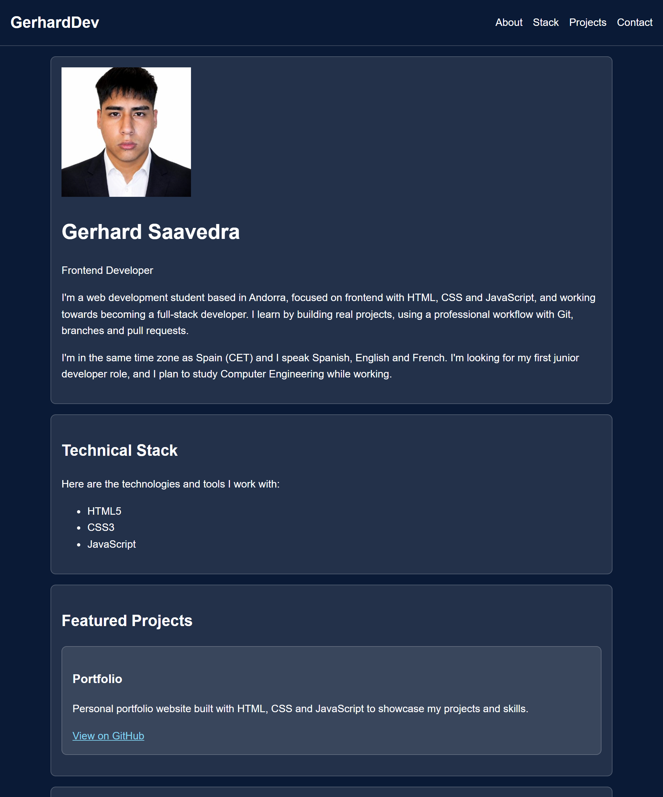

# Gerhard Saavedra – Portfolio
Personal portfolio website built with HTML and CSS to showcase my projects and skills.



## Live demo 
[View the live site](https://gerhardsaavedra.github.io/portfolio/)

## Tech stack
- HTML
- CSS
- Git
- GitHub
- GitHub Pages

## Features
- Navigation menu that jumps to each section
- Clean, centered layout with content organized in cards
- Accessible: keyboard navigation and high-contrast colors (WCAG AAA)
- Responsive: the menu adapts to small screens, so it works on mobile

## Run locally
```bash
git clone https://github.com/gerhardsaavedra/portfolio
```
Then open `index.html` in your browser.

## Technical decisions
- **CSS custom properties named by purpose** (`--text-color`, `--surface-color`): colors can be changed in one place, and the names still make sense if the palette changes.
- **Semantic HTML** (`header`, `nav`, `main`, `section`, `article`) instead of generic `div`s: it improves accessibility for screen readers, helps SEO and makes the code easier to read.
- **`box-sizing: border-box`** on all elements: padding and borders are included in the width, so element sizes are predictable and need no extra calculations.
- **Reusable `.card` class**: the card style is written once and reused for every section and project, so adding a new project only needs HTML.
- **Accessibility checked**: link colors tested with WebAIM (WCAG AAA contrast) and visible focus styles for keyboard navigation.

## Next steps
- Align the header with the main content on large screens.
- Add spacing between the contact links.
- Make images flexible (`max-width: 100%`).
- Add more projects, starting with "Electricity Price in Spain".